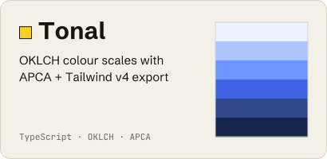
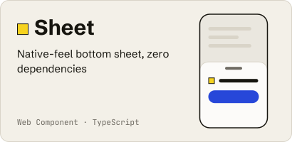
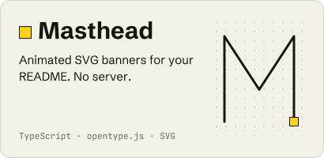

<a href="https://murali1801.vercel.app">
  <picture>
    <source media="(prefers-color-scheme: dark)" srcset="assets/masthead-dark.svg">
    
  </picture>
</a>

I design and build websites and mobile apps, and I like the details most people skip: how a sheet settles under your thumb, whether a colour still passes contrast in dark mode, what an app does with no signal.

Right now I'm making small open-source tools for colour, UI and READMEs. Everything below is MIT, runs in the browser and needs no account.

<table>
  <tr>
    <td width="50%" valign="top">
      <a href="https://github.com/Murali1801/tonal">
        <picture>
          <source media="(prefers-color-scheme: dark)" srcset="assets/card-tonal-dark.svg">
          
        </picture>
      </a>
      <a href="https://tonal-murali.vercel.app">Live</a> · <a href="https://github.com/Murali1801/tonal">Source</a> · TypeScript, OKLCH, APCA
    </td>
    <td width="50%" valign="top">
      <a href="https://github.com/Murali1801/sheet">
        <picture>
          <source media="(prefers-color-scheme: dark)" srcset="assets/card-sheet-dark.svg">
          
        </picture>
      </a>
      <a href="https://sheet-murali.vercel.app">Live</a> · <a href="https://github.com/Murali1801/sheet">Source</a> · Web Components, spring physics
    </td>
  </tr>
  <tr>
    <td width="50%" valign="top">
      <a href="https://github.com/Murali1801/tab">
        <picture>
          <source media="(prefers-color-scheme: dark)" srcset="assets/card-tab-dark.svg">
          
        </picture>
      </a>
      <a href="https://tab-murali.vercel.app">Live</a> · <a href="https://github.com/Murali1801/tab">Source</a> · PWA, IndexedDB, UPI
    </td>
    <td width="50%" valign="top">
      <a href="https://github.com/Murali1801/masthead">
        <picture>
          <source media="(prefers-color-scheme: dark)" srcset="assets/card-masthead-dark.svg">
          
        </picture>
      </a>
      <a href="https://masthead-murali.vercel.app">Live</a> · <a href="https://github.com/Murali1801/masthead">Source</a> · SVG, opentype.js, CLI
    </td>
  </tr>
</table>

The banner and cards on this page were made with Masthead.

**Stack** &nbsp;`TypeScript` `React` `Next.js` `Astro` `React Native / Expo` `Tailwind` `Firebase` `Supabase` `Python` `Shopify Liquid`

**Now** &nbsp;<!--now:start-->Shipping Tonal, Sheet, Tab and Masthead.<!--now:end-->

**Open to** &nbsp;freelance web and app builds, and design engineering roles.

■ <a href="https://murali1801.vercel.app">portfolio</a> · <a href="https://github.com/Murali1801?tab=repositories">all repositories</a>
